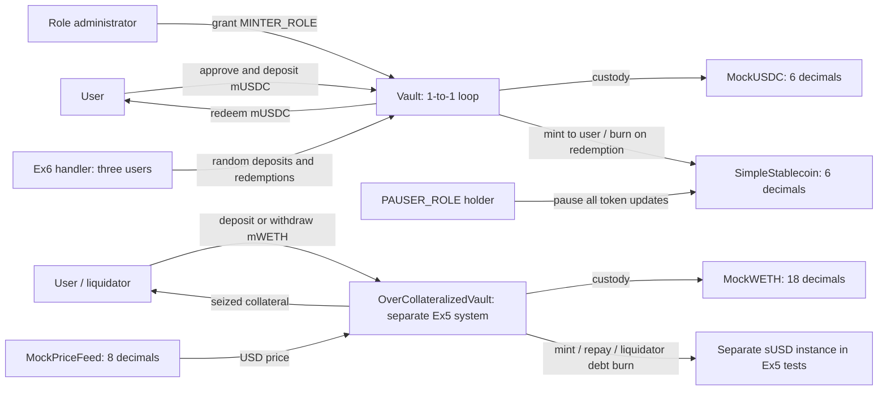

# Lab 1 — How to Create a Stablecoin

In this lab you build a **fiat-collateralized stablecoin** from scratch: deposit collateral to mint, burn to redeem, fully backed at every moment.

The core claim, up front:

> A stablecoin's "stability" does not come from the ERC-20 code — it comes from the **mint-redeem loop**.
> ERC-20 is only a bookkeeping format; anyone can write one in ten minutes. The real work is designing the loop and the permissions around it.

---

## 1. Setup

Pick the track that matches your machine. **Everything after this section is identical for everyone.**

| You are on | Track |
|---|---|
| macOS / Linux | **A** — install Foundry locally |
| Windows | **B** — Codespaces, nothing installed on your machine |

> `lib/` (`forge-std`, `openzeppelin-contracts`) **ships inside this repository**.
> Neither track needs `git clone --recursive`, and neither needs `make setup` —
> a plain clone compiles as-is.

### Track A — macOS / Linux

**Step 1. Install Foundry**

First check whether you already have it:

```bash
forge --version
```

If that prints a version, skip to Step 2. Otherwise install it with the script in this repo (**do not use `foundryup`**):

```bash
bash scripts/install-foundry-cn.sh
```

The script detects your platform (macOS ARM / Intel, Linux x86_64 / arm64), tries GitHub directly, and falls back to the `gh-proxy.com` mirror. Add the line it prints to `~/.zshrc` or `~/.bashrc`, then reopen your terminal:

```bash
export PATH="$PATH:$HOME/.foundry/bin"
```

> ⚠️ **Why not `foundryup`**: its 108 MB release download goes through GitHub's CDN,
> which measured ~33 KB/s from mainland China and times out reliably
> (`Operation timed out (os error 60)`). The mirror measured ~3 MB/s — 37 seconds.

**Step 2. Get the code**

```bash
git clone https://github.com/hgwoops/stablecoin-lab-2026 && cd stablecoin-lab-2026
```

Then go to **Verify** below.

### Track B — Windows (Codespaces)

Foundry has **no native Windows binary** — the official releases ship only macOS and Linux
builds, so `scripts/install-foundry-cn.sh` will refuse to run for you, and Git Bash /
PowerShell are not workarounds. The straightforward path is to run the lab on GitHub's
servers from your browser. Nothing is installed locally, which also makes it the only
option on locked-down corporate machines.

1. Open <https://github.com/hgwoops/stablecoin-lab-2026>
2. Green **`Code`** button → **`Codespaces`** tab → **`Create codespace on main`**
3. **The first launch takes 2–5 minutes**: it builds the environment from `.devcontainer/`,
   then automatically runs `make doctor` — you should see a row of `✓` in the terminal
4. In the terminal at the bottom, run:

```bash
make test
```

`7 passed; 0 failed` means you are set.

The free tier is 120 core-hours/month (≈ 60 real hours on a 2-core machine), far more than
this lab needs. **Stop it when you are done** at <https://github.com/codespaces> — a running
Codespace keeps burning quota.

> If you would rather have a local environment on Windows, install **WSL2 + Ubuntu** and then
> follow Track A inside it. That is a one-time configuration (enable virtualization in BIOS,
> enable "Virtual Machine Platform", one admin elevation), after which it is as fast as Linux.

### Verify (both tracks)

```bash
make doctor
```

In about 30 seconds this tells you whether the machine is ready for class: it checks the
toolchain, the dependencies, and actually runs the core tests. Anything marked `✗` comes with
the exact command to fix it.

All green means you can start. **If you cannot fix it, paste the entire `make doctor` output to the TA.**

---

## 2. Quick start

```bash
make doctor        # environment check — all green before you go on
make test          # Ex0 checkpoint: core tests, should be all green (7 passed)
make exercise      # the hands-on tasks; red right now — the red ones ARE your task list
make anvil         # terminal A: start a local chain
make deploy-anvil  # terminal B: deploy to it
```

Deployment prints three addresses — write them down (they are referred to below as `$USDC`,
`$SUSD`, `$VAULT`). For the full set of minting, balance-checking and on-chain commands, see
Ex1 and Ex3 in `EXERCISES.md`.

**Your task list lives in `EXERCISES.md`** — every exercise's goal, acceptance command, and
where to look when you get stuck.

---

## 3. What the three contracts do

| File | Role |
|---|---|
| `src/MockUSDC.sol` | **The collateral.** A mock USDC: 6 decimals, with a test faucet |
| `src/SimpleStablecoin.sol` | **The stablecoin itself.** ERC-20 + `MINTER_ROLE` (who may mint) + `PAUSER_ROLE` (whether transfers are frozen) |
| `src/Vault.sol` | **The loop.** Deposit collateral to mint 1:1; burn to take collateral back |

The key invariant: **`vault.totalCollateral() == stable.totalSupply()`**

As long as that equation holds, every coin is fully backed. The moment someone can mint out of
thin air without collateral appearing, the equation breaks and the coin stops being stable.

`script/Deploy.s.sol` wires all three together in a single command, and finishes by granting
`MINTER_ROLE` to the vault — **skip that step and every deposit reverts**.

`src/exercises/` is a second system to practise on: `OverCollateralizedVault.sol`
(over-collateralization + liquidation) together with `MockPriceFeed.sol` (a price feed you can
move by hand). Its four Ex5 operations implement valuation, minting, withdrawal, and liquidation.

---

## 4. Homework

### Tier 1 (required) — Ex0–Ex6 in `EXERCISES.md`

1. **Ex0 Environment**: `make doctor` all green → `make test` all green
2. **Ex1 The loop**: run it once from the command line — faucet mUSDC → `approve` → `deposit`
   to mint → `redeem` to get collateral back
3. **Ex2 Decimals trap**: write the two `test_Ex2_*` tests in `test/exercises/01_LoopTasks.t.sol`
4. **Ex3 Break the peg yourself**: use `cast` to grant `MINTER_ROLE` to an attacker and mint.
   Submit a screenshot of `totalSupply()` far exceeding `totalCollateral()`
5. **Ex4 Permissions and pausing**: write the five `test_Ex4_*` tests in the same file
6. **Ex5 Over-collateralization + liquidation**: fill in the four TODOs in
   `src/exercises/OverCollateralizedVault.sol` until `test/exercises/03_OverCollateralTasks.t.sol`
   is green
7. **Ex6 Invariant testing**: implement the handler's `redeem` and write two `invariant_*` tests
8. Answer the discussion questions in `STUDENT-QUESTIONS.md`

> Tier 1 does **not** require deploying to a testnet — a local Anvil is enough.
> The acceptance command for every exercise is `make exercise`; when you are done it should be all green.

### Tier 2 (bonus)

Deploy to the Sepolia testnet and verify the source on Etherscan; submit the contract links.

```bash
cp .env.example .env    # fill in private key, RPC URL, Etherscan API key
source .env
forge script script/Deploy.s.sol:Deploy \
  --rpc-url $SEPOLIA_RPC_URL --hardfork amsterdam --broadcast --verify --private-key $PRIVATE_KEY
```

**`--verify` needs `ETHERSCAN_API_KEY`** — free and takes seconds at
<https://etherscan.io/myapikey>. Leaving it empty still deploys fine: the contracts go on-chain
and only the verification step errors. **Do not redeploy because of it** — verify afterwards:

```bash
# one run per contract, with its own address and source file
forge verify-contract <address> src/SimpleStablecoin.sol:SimpleStablecoin \
  --chain sepolia --etherscan-api-key $ETHERSCAN_API_KEY
```

⚠️ Use a **fresh throwaway wallet** holding test ETH only. The private key must stay in `.env`,
which is already listed in `.gitignore` — **committing a private key scores zero**.

Sepolia test ETH: <https://cloud.google.com/application/web3/faucet/ethereum/sepolia>

### Tier 3 (challenge, optional)

Pick one:

- **Ex7 · Take the vault down**: `make challenge` (`test/challenges/Unstoppable.t.sol`, ported
  from Damn Vulnerable DeFi v4). You hold 10 DVT; the goal is to stop the vault from offering
  flash loans.
- **Peg Stability Module (PSM)**: add a 1:1 swap channel against another stablecoin, so that
  arbitrageurs pull the price back to peg for you.
- **Tighten the burn permission**: remove the centralization risk that the vault can burn
  anyone's balance — the code version of question A1 in `STUDENT-QUESTIONS.md`.
- **Wire in real Chainlink**: replace `MockPriceFeed` with Sepolia's `AggregatorV3Interface`.
  Read `decimals()` first; do not hardcode 8.

---

## 5. Common problems

**`Ownable` / role errors**
OpenZeppelin v5 has breaking changes, so v4 tutorials from the web will fail. This repo pins
`v5.0.2` — do not upgrade it.

**`ds-test/test.sol` not found, or `lib/` is empty**
`lib/` is bundled with the repo, so a normal `git clone` never hits this. You probably modified
`lib/`, or unzipped an archive without the directory. Restore it:

```bash
git checkout -- lib
```

**`deposit` keeps reverting after deployment**
Nine times out of ten you skipped `stable.grantRole(stable.MINTER_ROLE(), address(vault))`.
The vault has no minting right.

**Amounts are off by an order of magnitude**
`1000e6 = 1_000_000_000` in smallest units. Both tokens have 6 decimals — do not compute with 18.

**Addresses change after restarting Anvil**
Anvil starts from a clean state every time, so you must redeploy. To keep state, use
`anvil --load-state demo-state.json`.

**`make exercise` is all red**
That is expected — the tests under `test/exercises/` are **deliberately red**; they are your task
list. `make test` is the "everything is fine" checkpoint. Once you finish, `make exercise` goes green.

**`make exercise` hangs, or an invariant failure looks strange**
Foundry stores invariant counterexamples in `cache/invariant/` and replays them on the next run.
To search for a fresh counterexample, `rm -rf cache/invariant` first.

---

## 6. Submission

| Item | Weight |
|---|---|
| Contract correctness + test coverage | 40% |
| Deployment and Etherscan verification (Tier 2) | 20% |
| Threat-model analysis (discussion questions) | 25% |
| Code style and documentation | 15% |

Submit:

1. A link to your repo, with a screenshot of `forge test` passing
2. Tier 2: Sepolia contract addresses + Etherscan links
3. Your answers to the discussion questions in `STUDENT-QUESTIONS.md`
4. An architecture diagram in your README — a photo of a hand drawing is fine

---

## 7. Questions left to you

These have no standard answers. They are the real point of this lab:

1. The vault holds `MINTER_ROLE`, which means it can `burn` any user's balance. Is that
   acceptable? How would you change it?
2. Pausing freezes transfers, minting and **redemption** together. What happens when you freeze
   redemption in a crisis? How should a real system be designed?
3. Under what conditions does this coin depeg? Are "insufficient collateral" and "a blocked
   redemption channel" the same class of problem?
4. If the collateral were Treasuries or real estate instead of cash, how would you write the
   `totalCollateral()` invariant?

Question 4 is the door into next week's RWA lab.


## 8. Completed Tier 1 architecture and assumptions



The core vault exchanges six-decimal collateral and sUSD at 1:1. Ex6 restricts
random calls to its handler's deposit and redeem functions and checks
`totalCollateral() >= totalSupply()` plus a zero sUSD balance at the vault.
These properties cover that operation set; arbitrary transfers to the vault or
privileged unbacked minting are outside the handler's model.

Ex5 converts collateral value with `amount * price / 10^20`. Minting and
withdrawal require a resulting ratio of at least 150%; liquidation requires a
ratio below 120%. The liquidator burns the entire debt and receives collateral
worth 110% of that debt, capped by the borrower's available collateral. Any
unseized collateral stays assigned to the borrower. If backing is insufficient,
the liquidator still pays the full debt in this simplified model: the missing
bonus or principal value is an economic loss, not an outstanding debt balance
recorded after successful liquidation. A deeply underwater position may attract
no rational liquidator.

These mocks assume standard tokens, fixed decimal scales, and a valid positive
oracle price. Production would additionally require freshness checks, resilient
oracle design, arithmetic bounds, liquidity planning, and tighter privileges.
Ex0–Ex4 and existing screenshots were retained. Tier 2 is documented below. Tier 3 remains outside this completion;
no testnet deployment is required for Tier 1.


## 9. Tier 2 — verified Sepolia deployment

Deployed on **2026-10-12 (Asia/Shanghai)** to Ethereum Sepolia, chain ID
**11155111**, using `script/Deploy.s.sol:Deploy`. All three contracts have
verified source on Etherscan (Solidity `0.8.24`, optimizer enabled, 200 runs).

| Contract | Sepolia address | Etherscan |
|---|---|---|
| `MockUSDC` | `0xf97307c355e72934b79bc62c4e8c0df8b38ae898` | [Verified source](https://sepolia.etherscan.io/address/0xf97307c355e72934b79bc62c4e8c0df8b38ae898#code) |
| `SimpleStablecoin` | `0x3dbeb56849563ca98132d177fa4979f77cb763c9` | [Verified source](https://sepolia.etherscan.io/address/0x3dbeb56849563ca98132d177fa4979f77cb763c9#code) |
| `Vault` | `0x812c2674b3e6e39288d6e6e02fdd0d29e0bf84d0` | [Verified source](https://sepolia.etherscan.io/address/0x812c2674b3e6e39288d6e6e02fdd0d29e0bf84d0#code) |

All four transaction receipts report success:

- MockUSDC deployment: [transaction](https://sepolia.etherscan.io/tx/0xadfcea48310e0bee5aa78c68b9df033a8b3558352ac3d6c95d62fb699d784b51)
- SimpleStablecoin deployment: [transaction](https://sepolia.etherscan.io/tx/0x6191f2b7e29c0992b0a2fa7a44e1b48a7e0cf1f2e85309540307fd3796622505)
- Vault deployment: [transaction](https://sepolia.etherscan.io/tx/0x9e30c716af71672fc546f9449446754db07eb52d446f0f62ef69a666137a2c62)
- SimpleStablecoin MINTER_ROLE grant: [transaction](https://sepolia.etherscan.io/tx/0x70f1547fb4ef995304abad9eefda220453149aeb8068c3ac3f09bfc6abac3202)

Read-only checks confirmed that Vault points to the listed MockUSDC and
SimpleStablecoin, Vault holds `MINTER_ROLE`, sUSD uses six decimals, and the
initial supply and vault collateral are both zero.

The successful deployment and role grant consumed **0.012881256 Sepolia ETH**.
An initial attempt failed without creating a contract because the local runtime
underestimated state-creation gas; it consumed 0.000675333 test ETH.
The final run used `--hardfork amsterdam` to match Sepolia's upgraded runtime,
with each creation limit checked against the RPC node's estimate. Compilation
settings and contract sources were retained. See the
[official Sepolia upgrade announcement](https://blog.ethereum.org/2026/09/17/glamsterdam-testnet-announcement).

### Submission evidence

- [Core tests passing](screenshots/%E6%88%AA%E5%B1%8F2026-10-12%2012.19.33.png): `make test` — 7 passed, 0 failed.
- `make exercise` — 18 passed, 0 failed; Ex6 completed 256 runs and 128,000 calls.
- [Ex3 supply-versus-collateral screenshot](screenshots/%E6%88%AA%E5%B1%8F2026-10-12%2011.06.16.png).
- [Discussion answers](STUDENT-QUESTIONS.md), including the five Ex4 test names.
- Architecture diagram: section 8 above.

Only test ETH was used. `.env`, keys, build caches, and broadcast internals are
excluded from the submission. Tier 3 remains optional and was not completed.
